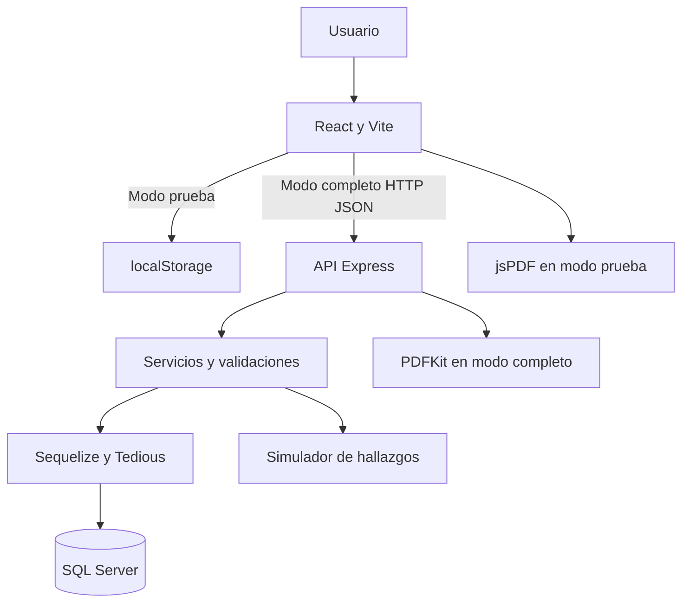

<div align="center">


# A11yPilot
### Plataforma de evaluación y seguimiento de accesibilidad web

**Ingeniería Web II · Entrega 1 · MVP 0.6.2**


**Universidad Manuela Beltrán · Ingeniería de Software**

[Repositorio](https://github.com/Codeforgeettttt/A11yPilot) · [Documentación API](docs/api/openapi.yaml) · [Registro de evidencias](docs/evidencias/README.md)

</div>

---

> [!IMPORTANT]
> **Estado actual:** MVP académico en desarrollo. Los hallazgos de accesibilidad provienen de **análisis simulados**, no de un escaneo real de la URL. El proyecto no certifica conformidad WCAG y no está preparado para despliegue público.

## 1. Descripción general

**A11yPilot** es una aplicación web para organizar la revisión y el seguimiento de accesibilidad en sitios web. Permite gestionar proyectos, registrar sitios autorizados, consultar hallazgos de ejemplo, registrar su seguimiento y generar informes. La primera versión incorpora una interfaz React con una API Express y persistencia local en Microsoft SQL Server.

La aplicación ofrece dos modos: **prueba**, que funciona sin backend ni base de datos, y **completo**, con cuentas de usuario, API REST y datos guardados en SQL Server. Ambos incluyen la exportación PDF de resultados de demostración.

## 2. Problema, necesidad y justificación

En proyectos de desarrollo web, los problemas de accesibilidad pueden detectarse tarde o quedar registrados en capturas y documentos separados. Esto dificulta organizar correcciones, asignarles seguimiento y comprobar qué se ha revisado. A ello se suma que los resultados técnicos de las herramientas de evaluación no siempre son fáciles de interpretar.

**Pregunta orientadora:** ¿Cómo organizar en una plataforma web la consulta y el seguimiento de hallazgos de accesibilidad para apoyar el proceso de mejora de sitios autorizados?

A11yPilot permite aplicar fundamentos de Ingeniería Web II: HTML semántico, estilos responsivos, componentes interactivos, comunicación con APIs, persistencia y pruebas funcionales.

## 3. Objetivos

### Objetivo general

Desarrollar una aplicación web que permita gestionar proyectos y sitios, presentar resultados de accesibilidad y realizar seguimiento a sus hallazgos, mediante una interfaz accesible y una arquitectura preparada para integrar análisis automatizados en fases posteriores.

### Objetivos específicos

1. Diseñar una interfaz responsive que respete la identidad visual del proyecto.
2. Implementar módulos de proyectos, sitios, análisis, hallazgos e informes.
3. Incorporar interactividad mediante formularios, filtros, navegación y cambios de estado.
4. Estructurar una API REST en Node.js y Express, conectada a SQL Server mediante Sequelize.
5. Generar informes PDF de demostración y distinguirlos claramente de resultados reales.
6. Documentar las pruebas de funcionamiento, accesibilidad y visualización en distintos tamaños de pantalla.

## 4. Alcance de la primera entrega

| Incluido | Próximas fases |
| :--- | :--- |
| Dashboard, proyectos, sitios, análisis, hallazgos, historial y reportes | Escaneo real mediante Playwright + axe-core |
| Registro e inicio de sesión con persistencia en modo completo | Administración avanzada de roles |
| Simulador de hallazgos y seguimiento | Comparación automática de revisiones reales |
| API REST y SQL Server para ejecución local | Cola de trabajos y navegador aislado |
| PDF de demostración en los dos modos | Análisis automático de URLs públicas autorizadas |
| Alto contraste, texto, espaciado y reducción de movimiento | Auditoría integral WCAG y despliegue público |
| Pruebas básicas y documentación | Migraciones versionadas del esquema |

**Usuarios destinatarios:** estudiantes de software, desarrolladores, equipos de calidad y responsables de sitios web que necesitan organizar hallazgos.

## 5. Funcionalidades

| Módulo | Descripción |
| :--- | :--- |
| **Cuentas** | Registro, acceso, cierre de sesión, perfil y recuperación de contraseña en modo completo |
| **Dashboard** | Indicadores, resumen y actividad de proyectos |
| **Proyectos** | Creación y administración de proyectos |
| **Sitios** | Registro de URLs con confirmación de autorización |
| **Nuevo análisis** | Ejecución de un flujo de evaluación **simulado** |
| **Hallazgos** | Búsqueda, filtros, clasificación y seguimiento |
| **Historial** | Consulta de análisis anteriores registrados |
| **Reportes** | PDF con resultados explícitamente demostrativos |
| **Accesibilidad** | Panel de contraste alto y preferencias de lectura |

**Flujo de uso:** entrar → crear proyecto → registrar sitio → confirmar autorización → ejecutar simulación → revisar hallazgos → actualizar seguimiento → descargar PDF.

## 6. Accesibilidad y diseño de interfaz

Se utiliza la identidad visual de A11yPilot: azul marino **#0B1F3A**, azul profundo **#0E243C** y turquesa **#43C6C8**. El [logotipo oficial](frontend/public/assets/logos/) está incluido como recurso del frontend. Las fuentes elegidas para la identidad son Intro Rust, Archivo Black y Nunito, con alternativas cuando sus archivos originales no están disponibles.

La interfaz contempla alto contraste, ajustes de tamaño de texto, espaciado, movimiento reducido y almacenamiento de preferencias en el navegador. También se han incorporado etiquetas, estructura semántica y controles de navegación mediante teclado.

> [!NOTE]
> Estas medidas son parte del desarrollo, **no una declaración de cumplimiento WCAG 2.2 AA**. Faltan pruebas sistemáticas de contraste, zoom, teclado y lectores de pantalla.

## 7. Arquitectura y datos



### Entidades principales

| Tabla | Propósito |
| :--- | :--- |
| `Users` | Cuentas de usuario |
| `Sessions` | Sesiones activas |
| `PasswordResets` | Solicitudes de restablecimiento |
| `Projects` | Proyectos vinculados a sus propietarios |
| `Sites` | Sitios asociados a proyectos |
| `Analyses` | Análisis de demostración |
| `Findings` | Hallazgos asociados a los análisis |
| `FindingUpdates` | Registro de seguimiento |
| `AnalysisEvents` | Eventos de ejecución |

La inicialización local se realiza mediante `sequelize.sync()` sin `force` ni `alter`. No equivale a migraciones de producción.

## 8. Tecnologías

| Capa | Tecnologías | Función |
| :--- | :--- | :--- |
| Web | HTML5, CSS3, JavaScript | Estructura, estilos e interactividad |
| Frontend | React 18, Vite 5, Lucide | Componentes y desarrollo |
| API | Node.js, Express 4 | Rutas y lógica de negocio |
| Base de datos | SQL Server Express | Persistencia local |
| Acceso a datos | Sequelize 6, Tedious | Modelos y consultas |
| Informes | jsPDF, PDFKit | Exportación PDF en ambos modos |
| Seguridad inicial | Helmet, CORS, rate limit | Controles de desarrollo |
| Pruebas | Node Test, Supertest, Vitest | Comprobaciones automatizadas |
| Documentación | Markdown, OpenAPI | Guías y contrato API |
| Versionamiento | Git, GitHub | Gestión de avances |

## 9. Organización del repositorio

```text
A11yPilot/
├── .github/workflows/      # Integración continua
├── frontend/
│   ├── public/assets/logos/
│   ├── src/
│   │   ├── accessibility/
│   │   ├── components/
│   │   ├── services/
│   │   ├── App.jsx
│   │   ├── Auth.jsx
│   │   ├── Root.jsx
│   │   ├── main.jsx
│   │   └── styles.css
│   ├── index.html
│   └── package.json
├── backend/
│   ├── scripts/
│   ├── src/
│   │   ├── config/
│   │   ├── models/
│   │   ├── routes/
│   │   ├── services/
│   │   ├── utils/
│   │   ├── app.js
│   │   └── server.js
│   ├── tests/
│   ├── .env.example
│   └── package.json
├── docs/
│   ├── api/
│   ├── arquitectura/
│   └── evidencias/
├── .gitignore
├── package.json
└── README.md
```

## 10. Instalación y ejecución

**Requisitos:** Node.js 20 o superior, npm y Windows PowerShell. Para el modo completo se requiere SQL Server Express con autenticación SQL, base de datos `A11yPilot` y conectividad TCP.

### Instalación de dependencias

```powershell
git clone https://github.com/Codeforgeettttt/A11yPilot.git
cd A11yPilot
npm.cmd run install:all
```

### Modo de prueba — sin SQL Server

```powershell
npm.cmd run dev:demo
```

Abrir **http://localhost:5173** y elegir el acceso de prueba. Los datos se guardan en `localStorage` y los reportes PDF se generan en el navegador. **Este acceso no crea una cuenta real ni guarda datos en la base de datos.**

### Modo completo — con SQL Server

Crear la base de datos `A11yPilot` en SQL Server y configurar un usuario de aplicación con permisos apropiados. Después:

```powershell
Copy-Item backend\.env.example backend\.env
notepad backend\.env
```

Editar `DB_HOST`, `DB_PORT`, `DB_NAME`, `DB_USER` y `DB_PASSWORD` según la instancia local. Nunca publicar el archivo `.env`.

```powershell
npm.cmd run db:setup
npm.cmd run dev
```

| Dirección local | Función |
| :--- | :--- |
| http://localhost:5173 | Aplicación web |
| http://127.0.0.1:3001/api/health | Estado de la API |
| http://127.0.0.1:3001/api/health/database | Estado de API y base de datos |

La instancia `SQLEXPRESS` puede usar puertos dinámicos; confirmar el puerto TCP en la configuración local.

### Comandos útiles

| Comando | Descripción |
| :--- | :--- |
| `npm.cmd run dev:demo` | Frontend sin backend |
| `npm.cmd run dev` | Frontend y backend |
| `npm.cmd run db:setup` | Preparación de tablas |
| `npm.cmd run db:seed` | Datos de demostración configurados |
| `npm.cmd run build` | Compilar frontend |
| `npm.cmd run test` | Ejecutar pruebas |

## 11. Seguridad y limitaciones

En el modo completo, las cuentas utilizan hash de contraseña con `scrypt` y sesiones revocables en SQL Server con cookies `HttpOnly`. Las operaciones sobre recursos se asocian al usuario autenticado. Hay controles básicos de validación, cabeceras y límites de solicitudes.

**Este entorno se diseñó para ejecución local:** faltan revisión integral de seguridad, controles CSRF adicionales según despliegue, HTTPS de producción, migraciones versionadas y un motor de análisis aislado con protección SSRF. No se debe exponer la API directamente a Internet con la configuración de desarrollo. Los parámetros `DB_ENCRYPT=false`, `DB_TRUST_CERT=true` y `DEV_SHOW_RESET_LINK=true` son únicamente de laboratorio.

## 12. Estado de avance, pruebas y evidencias

| Elemento | Estado |
| :--- | :--- |
| Código fuente en GitHub | Publicado |
| Frontend y backend | Implementados en el repositorio |
| Conexión a SQL Server | Probada localmente durante el desarrollo |
| Registro y acceso | Probados manualmente en entorno local |
| Reportes PDF y panel de accesibilidad | Incluidos en el código |
| Pruebas automatizadas | Incluidas; resultados pendientes de registrar |
| Capturas responsive | Pendientes de documentar |
| Pruebas manuales con lectores de pantalla | Pendientes |
| Análisis reales de sitios | No implementados |
| Certificación de conformidad WCAG | No disponible |

Las capturas reales y resultados se documentarán en **[docs/evidencias](docs/evidencias/README.md)**. Se requieren vistas de escritorio, móvil y tableta, interacciones principales, alto contraste y un PDF generado. No incluir credenciales ni datos privados en esas capturas.

Para realizar las comprobaciones disponibles:

```powershell
npm.cmd run build
npm.cmd run test
```

## 13. Siguientes fases

1. **Cierre de Entrega 1:** registrar pruebas, ajustar responsive y revisar accesibilidad.
2. **Motor real:** integrar Playwright y axe-core para URLs públicas autorizadas.
3. **Seguridad del análisis:** validación contra SSRF, aislamiento del navegador y límites de ejecución.
4. **Seguimiento avanzado:** comparar revisiones y mejorar informes.
5. **Evolución del sistema:** migraciones versionadas, roles, despliegue y pruebas de producción.

---

<div align="center">

**A11yPilot · Universidad Manuela Beltrán · Ingeniería Web II**

*El proyecto se desarrolla por fases. Los análisis de esta entrega son demostrativos y no representan auditorías reales de accesibilidad.*

</div>
