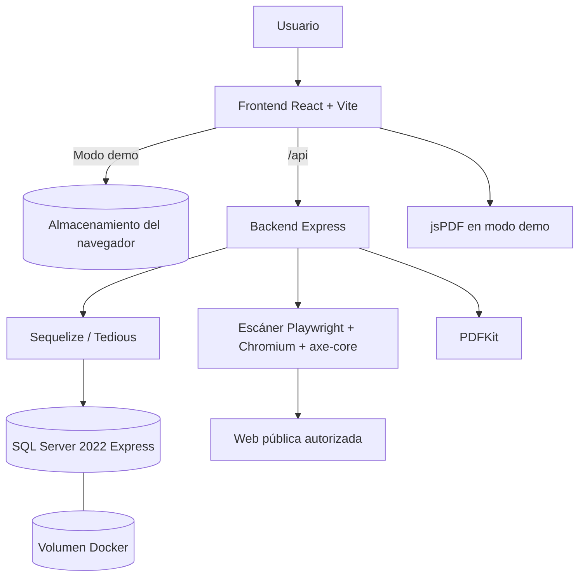

<div align="center">


# A11yPilot

### Plataforma de evaluación y seguimiento de accesibilidad web

**Ingeniería Web II · Universidad Manuela Beltrán · Ingeniería de Software**


[Instalación](docs/manuales/INSTALACION.md) · [Manual de usuario](docs/manuales/USUARIO.md) · [Arquitectura Docker](docs/arquitectura/DESPLIEGUE_DOCKER.md) · [Pruebas](docs/pruebas/PLAN_PRUEBAS.md) · [Historial](CHANGELOG.md)

</div>

> [!IMPORTANT]
> **Estado del repositorio (16 de noviembre de 2026):** la rama `main` contiene el frontend, la API, SQL Server con Docker Compose y el motor de análisis automatizado con Playwright + axe-core. Hay pruebas de CI aprobadas, pero **la ejecución integral de SQL Server y escaneos reales en Docker aún requiere evidencia manual**. **No existe una release v1.0.0 publicada** y el proyecto **no certifica conformidad WCAG**. Es un despliegue de desarrollo **local**, no un servicio público de producción.

## 1. ¿Qué es A11yPilot?

A11yPilot permite registrar proyectos y sitios web autorizados, ejecutar evaluaciones automatizadas de accesibilidad cuando se utiliza la API real, revisar hallazgos, actualizar sus estados, consultar el historial y descargar informes PDF. Su objetivo académico es demostrar una solución web integrada, accesible y organizada para acompañar la mejora continua de sitios.

**Problema que aborda:** los equipos necesitan centralizar hallazgos de accesibilidad y dar seguimiento a sus correcciones sin depender de documentos aislados.

**Objetivo general:** desarrollar una plataforma web para registrar, evaluar y dar seguimiento a problemas de accesibilidad mediante una interfaz accesible y una arquitectura con API y persistencia.

### Alcance funcional

| Área | Implementación en el repositorio |
| --- | --- |
| Cuentas | Registro, inicio/cierre de sesión, perfil y recuperación de contraseña en modo completo |
| Proyectos y sitios | CRUD de proyectos, registro/edición de sitios con declaración de autorización |
| Dashboard | Resumen de proyectos, análisis y hallazgos |
| Análisis real | Playwright + Chromium + axe-core en backend sobre URLs públicas autorizadas |
| Seguimiento | Filtros, estados y observaciones de hallazgos, eventos e historial |
| Informes | Exportación PDF en modo completo; PDF de ejemplo en modo demo |
| Accesibilidad | Alto contraste, tamaño de texto, espaciado, movimiento reducido y soporte de teclado |
| Modo demo | Datos **simulados** en el navegador, sin backend ni SQL Server |
| Contenedores | Dockerfiles, Compose, inicialización de base de datos y volumen SQL persistente |

> Los resultados automáticos son **ayudas para identificar problemas**, no una auditoría exhaustiva ni una certificación WCAG 2.2 AA. Las verificaciones manuales siguen siendo necesarias.

## 2. Cómo ejecutarlo con Docker — modo completo

**Requisitos:** Docker Desktop con motor Linux y Docker Compose V2. Reserva memoria suficiente para SQL Server y Chromium (consulta el [manual de instalación](docs/manuales/INSTALACION.md)). Si ya estás ejecutando A11yPilot con PM2, detén esos procesos antes de usar los mismos puertos.

En PowerShell:

```powershell
git clone https://github.com/Codeforgeettttt/A11yPilot.git
cd A11yPilot
Copy-Item .env.docker.example .env
notepad .env
```

En `.env`, reemplaza `MSSQL_SA_PASSWORD` con una contraseña **nueva, privada y fuerte**. Nunca subas `.env` a GitHub.

```powershell
docker compose config --quiet
docker compose up --build -d
docker compose ps -a
```

| Dirección | Descripción |
| --- | --- |
| http://localhost:5173 | Aplicación completa |
| http://localhost:3001/api/health | Salud de la API |
| http://localhost:3001/api/health/database | Salud de API y base de datos |

El servicio `db-init` **debe terminar con código 0** tras preparar la base; no es un fallo que quede detenido después. El servicio `db` utiliza **SQL Server 2022 Express** (imagen declarada en `docker-compose.yml`) y un volumen Docker persistente `sqlserver_data`. El puerto SQL 1433 no se expone al equipo.

**Ver errores / apagar sin borrar datos:**

```powershell
docker compose logs --tail=150 db db-init backend frontend
docker compose down
```

> [!CAUTION]
> `docker compose down -v` **puede eliminar permanentemente** los datos del volumen. No lo uses para detener el proyecto de manera habitual. El SQL Server del contenedor **no importa automáticamente** los datos de tu SQL Server Express de Windows.

## 3. Modo demo sin base de datos

```powershell
docker compose -f compose.demo.yaml up --build -d
```

Abre **http://localhost:5174** y utiliza el acceso de prueba. Este modo no ejecuta escaneos reales ni crea cuentas en SQL Server: los datos de ejemplo se guardan en el navegador.

Para detenerlo:

```powershell
docker compose -f compose.demo.yaml down
```

## 4. Ejecución sin Docker (desarrollo)

**Requisitos:** Node.js compatible, npm y, para el modo completo, una instancia SQL Server configurada y accesible.

```powershell
npm.cmd run install:all
npm.cmd run dev:demo  # solamente frontend; resultados simulados
```

Para usar el backend local, prepara `backend/.env` a partir de `backend/.env.example`, configura las credenciales de tu SQL Server y ejecuta `npm.cmd run db:setup` (solo en una base destinada al proyecto) y `npm.cmd run dev`.

El backend utiliza Playwright; fuera de Docker debes instalar Chromium y sus dependencias de acuerdo con el manual de Playwright. No ejecutes simultáneamente una instancia PM2 y otra de desarrollo en los mismos puertos.

## 5. Cómo usar la plataforma

1. Accede o registra una cuenta (modo completo).
2. Crea un proyecto y registra un sitio web que tengas permiso de revisar.
3. Selecciona **Nuevo análisis**. En el modo completo puedes iniciar la evaluación real; en modo demo se generan ejemplos simulados.
4. Consulta el progreso, el historial y los hallazgos.
5. Actualiza estados, registra observaciones y descarga un informe.

El escáner se basa en Chromium y axe-core, y utiliza validaciones de URL y un proxy restrictivo. **No debe considerarse seguro para exponerse como servicio público sin una revisión adicional de SSRF, aislamiento, límites y autenticación.** No evalúes sitios sin autorización.

## 6. Arquitectura



**Servicios Compose:** `frontend`, `backend`, `db-init`, `db`; una red interna y volumen `sqlserver_data`. El escáner forma parte del backend, no es un quinto contenedor independiente. Consulta [arquitectura detallada](docs/arquitectura/DESPLIEGUE_DOCKER.md).

**Modelos principales:** `Users`, `Sessions`, `PasswordResets`, `Projects`, `Sites`, `Analyses`, `Findings`, `FindingUpdates` y `AnalysisEvents`. El proyecto usa Sequelize; la preparación de tablas todavía no reemplaza un sistema de migraciones versionadas para producción.

## 7. Tecnologías y estructura

| Capa | Tecnologías |
| --- | --- |
| Interfaz | HTML5, CSS3, JavaScript, React 18, Vite 5, Lucide |
| Servidor | Node.js, Express, Helmet, CORS, rate limiting |
| Acceso a datos | Sequelize 6, Tedious, Microsoft SQL Server |
| Análisis | Playwright, Chromium, @axe-core/playwright |
| PDF | PDFKit (API) y jsPDF (demo) |
| Calidad | Node Test, Supertest, Vitest, ESLint, Prettier, GitHub Actions |
| Despliegue local | Docker, Docker Compose |

```text
A11yPilot/
├── frontend/             # Interfaz, componentes, páginas y modo demo
├── backend/              # API, modelos, motor de análisis y pruebas
├── docs/
│   ├── api/              # Contrato OpenAPI
│   ├── arquitectura/     # Decisiones y Docker
│   ├── manuales/         # Instalación y usuario
│   ├── pruebas/          # Matriz de verificaciones
│   ├── evidencias/       # Capturas y resultados
│   ├── diseno/           # Identidad visual y manual PDF
│   ├── control-versiones/
│   └── entrega/          # Lista de aprobación de versión
├── .github/workflows/    # CI de Node y Docker
├── docker-compose.yml    # Aplicación completa con SQL Server
├── compose.demo.yaml     # Modo demo sin backend
├── .env.docker.example   # Ejemplo de secretos privados
├── CHANGELOG.md
└── README.md
```

## 8. Pruebas, estado y limitaciones

Pruebas ejecutables:

```powershell
npm.cmd run build
npm.cmd run test
npm.cmd run lint
```

Las ejecuciones recientes de **GitHub Actions** incluyen verificaciones aprobadas de código y flujos de construcción. Puedes revisar los resultados y los commits exactos en [Actions](https://github.com/Codeforgeettttt/A11yPilot/actions). Los CI aprobados **no sustituyen** las pruebas integrales en un PC con Docker y SQL Server.

| Verificación | Estado |
| --- | --- |
| Código del frontend, API, Docker y análisis real | Incluido en `main` |
| Pruebas automatizadas y construcción de imágenes | Evidencia disponible en GitHub Actions |
| Levantamiento completo de SQL Server y persistencia en Compose | **Prueba manual pendiente de documentar** |
| Escaneo real, seguimiento y PDF de principio a fin | **Prueba integral pendiente** |
| Teclado, lectores de pantalla y diferentes tamaños de pantalla | **Revisión manual pendiente** |
| Conformidad certificada WCAG o despliegue público | **No alcanzados** |

**Seguridad:** `.env` y las contraseñas no deben publicarse; `DB_TRUST_CERT` y `DEV_SHOW_RESET_LINK` son opciones de laboratorio. Antes de ofrecer el servicio en Internet hacen falta HTTPS, aislamiento del navegador, protección de secretos, pruebas de seguridad y endurecimiento adicional.

## 9. Documentación y seguimiento

- [Manual de instalación](docs/manuales/INSTALACION.md)
- [Manual de usuario](docs/manuales/USUARIO.md)
- [Arquitectura Docker](docs/arquitectura/DESPLIEGUE_DOCKER.md)
- [Decisiones técnicas](docs/arquitectura/DECISIONES.md)
- [Referencia de API](docs/api/openapi.yaml)
- [Plan y registro de pruebas](docs/pruebas/PLAN_PRUEBAS.md)
- [Evidencias del proyecto](docs/evidencias/README.md)
- [Manual de identidad visual](docs/diseno/README.md)
- [Control de versiones](docs/control-versiones/README.md)
- [CHANGELOG](CHANGELOG.md)
- [Preparación de release 1.0.0](docs/entrega/RELEASE_1.0.0.md)

**Control de versiones:** rama principal `main`, desarrollo registrado en commits y CI. Las versiones declaradas en los paquetes siguen en `0.6.2` (raíz/frontend) y `0.6.0` (backend). **No se afirma la publicación de v1.0.0 mientras no exista una release aprobada.**

---

<div align="center">

**A11yPilot · Ingeniería Web II · Universidad Manuela Beltrán**

*La evaluación automatizada orienta la revisión: no reemplaza una auditoría humana de accesibilidad.*

</div>
