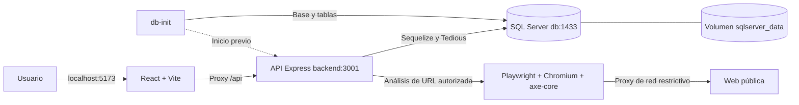
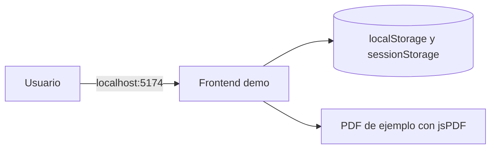

# Arquitectura de contenedores — A11yPilot

## Requisitos y componentes

| Componente           | Tecnología                       | Función                                      |
| -------------------- | -------------------------------- | -------------------------------------------- |
| `frontend`           | React + Vite                     | Interfaz web y proxy HTTP de `/api`          |
| `backend`            | Node.js + Express                | Cuentas, proyectos, análisis y reportes      |
| Escáner en `backend` | Playwright + Chromium + axe-core | Evaluación real de URLs públicas autorizadas |
| `db-init`            | Node.js + Sequelize              | Crea la base y prepara tablas si faltan      |
| `db`                 | SQL Server 2022 Express          | Persistencia de datos                        |
| `sqlserver_data`     | Volumen Docker                   | Conserva la información entre reinicios      |

Los servicios operan en la red `internal` de Compose. La base no publica el puerto 1433, y el frontend y la API se publican solo en la interfaz de loopback del equipo.

## Diagrama: modo completo

La base `db` inicia primero y se verifica mediante una comprobación de disponibilidad. `db-init` prepara la base y las tablas; solo al completarse con éxito comienza `backend`. El frontend redirige las llamadas a la API.

La imagen del backend instala Chromium y las dependencias de sistema con `npx playwright install --with-deps chromium`, usando la versión de Playwright fijada por `backend/package-lock.json`.

## Diagrama: modo demostración (F30)

Este modo es independiente de SQL Server y Express. Sus hallazgos son simulados; no ejecuta Playwright.

## Decisiones y límites

1. `docker-compose.yml` integra el modo completo; `compose.demo.yaml` permite levantar únicamente el frontend.
2. Las contraseñas se cargan desde `.env` privado, no se escriben en los Dockerfile.
3. `HOST=0.0.0.0` habilita la API dentro del contenedor, mientras la publicación del puerto está restringida a `127.0.0.1` en el equipo.
4. `API_PROXY_TARGET=http://backend:3001` comunica Vite con la API.
5. La integración del escáner real requiere un navegador Chromium y librerías del sistema en la imagen del backend.
6. La configuración sigue siendo de desarrollo: requiere pruebas integrales de seguridad, HTTPS, revisión de infraestructura y servidor web de producción antes de desplegarse públicamente.

Consulta la [guía de despliegue](../despliegue/README.md) para instalación y comprobaciones.
