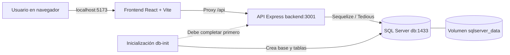
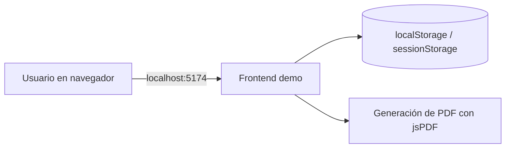

# Arquitectura de contenedores — A11yPilot

## Requisitos del entorno

| Elemento | Requisito |
| --- | --- |
| Motor | Docker Desktop / Docker Engine con Compose V2 |
| Plataforma | Contenedores Linux; SQL Server 2022 |
| Servicios | `frontend`, `backend`, `db-init`, `db` |
| Credenciales | `MSSQL_SA_PASSWORD` en `.env` local no versionado |
| Red | `internal` de Docker; SQL Server no expuesto |
| Persistencia | Volumen `sqlserver_data` para datos de SQL Server |
| Alcance | Desarrollo y demostración locales, sin acceso público |

## Arquitectura del modo completo

El servicio `db` arranca primero. `db-init` espera que SQL Server esté listo, crea la base `A11yPilot` si no existe e inicializa tablas mediante el script de proyecto. Después arranca el backend, y finalmente el frontend.

## Arquitectura del modo demo

El modo demo es independiente y no consulta la base de datos ni la API; se activa seleccionando el acceso de demostración de la interfaz.

## Decisiones técnicas

1. Un archivo `docker-compose.yml` integra los servicios para uso local, y `compose.demo.yaml` simplifica la demostración sin dependencias.
2. `db-init` separa la inicialización del esquema del arranque habitual del backend y permite conservar el volumen entre ejecuciones.
3. Las credenciales se leen del archivo `.env` local, nunca de los Dockerfile ni del código versionado.
4. La API conserva `127.0.0.1` cuando se ejecuta fuera de Docker; dentro del contenedor recibe `HOST=0.0.0.0`.
5. Vite permite configurar `API_PROXY_TARGET` para resolver el backend por nombre de servicio.
6. Se mantienen hallazgos simulados; la configuración no incorpora Playwright, axe-core ni análisis reales de sitios.

Consulta la [guía de ejecución](../despliegue/README.md) para comandos y verificaciones.
