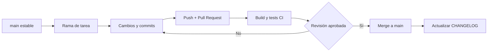

# Control de versiones · A11yPilot

**Proyecto:** A11yPilot · Ingeniería Web II  
**Repositorio oficial:** https://github.com/Codeforgeettttt/A11yPilot  
**Rama principal:** `main`  
**Versión de aplicación declarada en el proyecto:** `0.6.2`  
**Fecha de revisión del historial:** 10 de noviembre de 2026

Este documento explica cómo se registran, verifican y organizan los cambios del proyecto. **Git** conserva el historial de cada modificación y **GitHub** publica el código, facilita su revisión y ejecuta pruebas automáticas.

> La versión `0.6.2` proviene del `package.json` principal y del frontend. **No equivale a una versión etiquetada o publicada en GitHub Releases.** El backend mantiene su versión interna `0.6.0`.

## 1. Estado actual y estrategia

| Elemento | Aplicación en A11yPilot |
| --- | --- |
| Sistema de versionado | Git |
| Repositorio remoto | GitHub público |
| Rama principal | `main` |
| Convención para nuevos commits | Conventional Commits |
| Versionado de la aplicación | `MAJOR.MINOR.PATCH` (propuesta para siguientes entregas) |
| Registro explicativo de cambios | [CHANGELOG.md](../../CHANGELOG.md) |
| Documentación y evidencias | `docs/` |
| Integración continua | [Node.js CI](../../.github/workflows/node.js.yml) |
| Publicación de versión final | Propuesta: etiqueta `vX.Y.Z` y GitHub Release al cerrar cada entrega |

Actualmente el historial del repositorio existe y contiene commits reales. La guía de ramas y etiquetado siguiente es una **política propuesta para el trabajo futuro**, no una afirmación de que ya se hayan creado dichas ramas o etiquetas.

## 2. Historial de hitos reales

Los siguientes hitos se obtuvieron del historial público de `main` y corresponden a los cambios que quedaron registrados:

| Fecha | Commit | Cambio documentado |
| --- | --- | --- |
| 03/11/2026 | [`ac4c9c9`](https://github.com/Codeforgeettttt/A11yPilot/commit/ac4c9c9b68) | Creación inicial del repositorio |
| 10/11/2026 | [`26fc3ce`](https://github.com/Codeforgeettttt/A11yPilot/commit/26fc3ce81e) | Publicación del MVP inicial (frontend, backend y documentación) |
| 10/11/2026 | [`807bc93`](https://github.com/Codeforgeettttt/A11yPilot/commit/807bc93b99) | Incorporación del workflow Node.js CI |
| 10/11/2026 | [`833fed3`](https://github.com/Codeforgeettttt/A11yPilot/commit/833fed32af) | Objetivo, alcance y requisitos de la primera entrega |
| 10/11/2026 | [`a437972`](https://github.com/Codeforgeettttt/A11yPilot/commit/a4379723bc) | Registro de pruebas y evidencias |
| 10/11/2026 | [`96e4b35`](https://github.com/Codeforgeettttt/A11yPilot/commit/96e4b357a4) | Ampliación del README académico y técnico |
| 10/11/2026 | [`2062ce7`](https://github.com/Codeforgeettttt/A11yPilot/commit/2062ce7138) | Corrección de instalación de dependencias en GitHub Actions |
| 10/11/2026 | [`fd06ced`](https://github.com/Codeforgeettttt/A11yPilot/commit/fd06cedc50) | Actualización del registro de evidencias |
| 10/11/2026 | [`c070005`](https://github.com/Codeforgeettttt/A11yPilot/commit/c070005bb0) | Ajustes de imágenes en la documentación |
| 10/11/2026 | [`cd4ee73`](https://github.com/Codeforgeettttt/A11yPilot/commit/cd4ee73387) | Creación del apartado de identidad visual |
| 10/11/2026 | [`8c84113`](https://github.com/Codeforgeettttt/A11yPilot/commit/8c84113a8a) | Carga del documento original de diseño |
| 10/11/2026 | [`f883603`](https://github.com/Codeforgeettttt/A11yPilot/commit/f883603215) | Enlace del PDF desde la documentación |

El historial completo, incluidos cambios intermedios, se consulta en **[Commits de main](https://github.com/Codeforgeettttt/A11yPilot/commits/main/)**.

## 3. Convenciones de mensajes de commit

Formato recomendado:

```text
tipo(alcance): descripción breve
```

| Tipo | Se utiliza para | Ejemplo |
| --- | --- | --- |
| `feat` | Nueva funcionalidad | `feat(proyectos): añadir filtros` |
| `fix` | Corrección de fallos | `fix(auth): corregir validación de origen` |
| `docs` | Documentación | `docs: agregar evidencias responsive` |
| `test` | Pruebas | `test(api): verificar permisos de proyectos` |
| `refactor` | Mejora interna sin alterar comportamiento | `refactor(frontend): separar componentes` |
| `style` | Ajustes visuales o formato | `style(ui): mejorar espaciado móvil` |
| `ci` | Integración continua | `ci: ejecutar build y test` |
| `chore` | Mantenimiento | `chore: actualizar dependencias` |

Reglas: redactar mensajes específicos, mantener un cambio lógico por commit, no añadir contraseñas ni archivos `.env`, y comprobar que se está usando la rama correcta.

## 4. Flujo de trabajo propuesto



### Nombres de ramas recomendados

- `feat/nombre-corto`: funcionalidades nuevas.
- `fix/nombre-corto`: correcciones.
- `docs/nombre-corto`: documentación.
- `test/nombre-corto`: pruebas.

Para una entrega individual o un cambio documental sencillo es posible trabajar directamente en `main`; para cambios de código relevantes se recomiendan ramas y pull requests.

## 5. Comandos esenciales

Ejecutar desde el repositorio clonado:

```powershell
git status
git pull origin main
git switch -c docs/actualizar-evidencias

# Hacer modificaciones y comprobarlas:
git status
git add docs/evidencias/README.md
git commit -m "docs: actualizar registro de pruebas"
git push -u origin docs/actualizar-evidencias
```

Después se abre un Pull Request hacia `main` y se revisan las comprobaciones. Si se trabaja directamente sobre `main`:

```powershell
git pull origin main
git add .
git commit -m "docs: actualizar documentación"
git push origin main
```

**Antes de `git add .`**, revisar `git status`, el archivo `.gitignore` y los cambios para evitar publicar datos sensibles.

Otros comandos útiles:

```powershell
git log --oneline --graph --decorate -15
git diff
git show HEAD
git tag --list
```

## 6. Versiones propuestas para el semestre

En futuras entregas se recomienda seguir un esquema cercano a **Semantic Versioning**:

- `MAJOR`: cambios incompatibles o reorganizaciones significativas.
- `MINOR`: funcionalidades nuevas compatibles.
- `PATCH`: correcciones pequeñas compatibles.

**Versión actual documentada: `0.6.2` (MVP).** Los números de las próximas versiones se asignarán **cuando se implementen y comprueben los cambios**; no se deben presentar planes como versiones ya entregadas.

Al cerrar una entrega se recomienda: ejecutar build y pruebas, actualizar `CHANGELOG.md`, confirmar capturas y documentación, crear una etiqueta Git (por ejemplo `v0.6.2` si se decide formalizar esa versión) y publicar un Release con las limitaciones conocidas. **Esta política no implica que se haya creado esa etiqueta ahora.**

## 7. Calidad y trazabilidad

El workflow [`.github/workflows/node.js.yml`](../../.github/workflows/node.js.yml) instala dependencias de la raíz, del frontend y del backend, compila la interfaz y ejecuta las pruebas con Node.js 20, 22 y 24. Las ejecuciones exitosas se pueden verificar en [GitHub Actions](https://github.com/Codeforgeettttt/A11yPilot/actions).

Cada entrega debería mantener relacionados:

1. **Código:** commit o Pull Request que implementó el cambio.
2. **Prueba:** resultado automatizado o comprobación manual documentada.
3. **Evidencia:** captura o documento en [`docs/evidencias/`](../evidencias/README.md).
4. **Versión:** entrada correspondiente en [`CHANGELOG.md`](../../CHANGELOG.md).

## 8. Limitaciones actuales

- El análisis de accesibilidad real con Playwright y axe-core **no está implementado**: los hallazgos del MVP son simulados.
- La ejecución con SQL Server requiere configurar la instancia y las credenciales **localmente**.
- La existencia de pruebas automáticas exitosas no sustituye validaciones manuales responsive y de accesibilidad.
- Este documento constituye **control y documentación del proceso de versiones**; Git es quien mantiene el historial técnico auténtico.

---

**Registro consultado:** [historial de A11yPilot](https://github.com/Codeforgeettttt/A11yPilot/commits/main/).  
**Para cambios posteriores:** actualizar primero `CHANGELOG.md` y este documento si cambian las reglas o se formaliza una nueva entrega.
